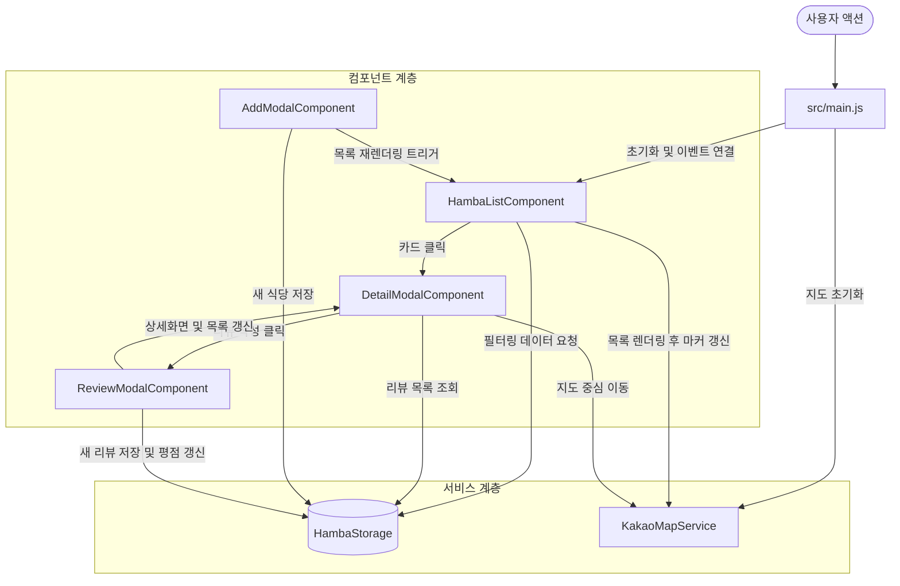

# 🍱 함바여지도 웹 애플리케이션 (hamba-web) 소스파일 기능 목록

본 문서는 **"선택지 A: 바닐라 JS + Vite 모듈화"** 방식으로 분리된 `hamba-web` 프로젝트의 전체 디렉토리 구조 및 각 소스 파일별 기능과 역할을 정리한 기술 문서입니다.

---

## 🌳 전체 디렉토리 구조

```text
hamba-web/
├── index.html                      # HTML5 메인 템플릿 및 Kakao Maps SDK 로드
├── package.json                    # 프로젝트 메타데이터 및 Vite 스크립트
├── vite.config.js                  # Vite 개발 서버 설정 (포트 3000 고정)
├── run-web-server.bat              # 원클릭 Vite 로컬 서버 실행 배치 파일
├── FILE_STRUCTURE.md               # [현재 문서] 소스파일 기능 목록 및 아키텍처 가이드
├── README.md                       # 프로젝트 개요 및 실행 가이드
└── src/
    ├── main.js                     # 애플리케이션 엔트리포인트 (통합 조율 허브)
    ├── data/
    │   └── initialData.js          # 초기 샘플 식당 및 리뷰 목업 데이터
    ├── services/
    │   ├── storage.js              # LocalStorage 데이터 CRUD 및 평점 계산 전담
    │   └── kakaoMap.js             # 카카오 지도 SDK 연동, 커스텀 마커, GPS, 폴백 지도
    ├── components/
    │   ├── hambaList.js            # 하단 바텀시트 식당 목록 렌더링 & 검색/필터링
    │   ├── detailModal.js          # 식당 상세정보 팝업 및 리뷰 목록 표출
    │   ├── addModal.js             # 신규 식당 등록 폼 모달 및 데이터 추가 처리
    │   └── reviewModal.js          # 방문자 리뷰 및 별점 작성 팝업 처리
    ├── utils/
    │   ├── modal.js                # 모달 열기/닫기/배경클릭 공통 유틸리티
    │   └── toast.js                # 화면 하단 인터랙티브 토스트 알림 유틸리티
    └── styles/
        ├── variables.css           # 디자인 시스템 색상 변수, 폰트, 리셋, 스플래시 화면
        ├── layout.css              # 헤더, 지도 영역, 바텀시트, 플로팅 버튼 레이아웃
        ├── components.css          # 식당 카드, 북마크 하트, 가격 뱃지, 지도 오버레이
        └── modal.css               # 팝업 모달창, 폼 입력 필드, 토스트 메시지 스타일
```

---

## 📂 파일별 상세 기능 목록

### 1. 루트 설정 및 진입점 (Root & Config)

| 파일 경로 | 주요 역할 및 기능 |
| :--- | :--- |
| `index.html` | • HTML5 시맨틱 마크업 구조 정의 (헤더, 지도 컨테이너, 바텀시트, 4종 모달, 토스트)<br>• 카카오 지도 JS SDK (`dapi.kakao.com`) 스크립트 로드 (`autoload=false` 명시)<br>• Vite ES 모듈 진입점 (`<script type="module" src="/src/main.js">`) 연결 |
| `package.json` | • `"type": "module"` 선언으로 최신 ES Modules 지원<br>• 실행 스크립트 등록: `npm run dev` (Vite 서버 실행), `npm run build` (배포 번들링)<br>• 초경량 개발 의존성 (`vite ^5.4.11`) 관리 |
| `vite.config.js` | • 카카오 개발자 콘솔에 등록된 승인 도메인(`http://localhost:3000`)에 맞춰 개발 서버 포트를 `3000`으로 고정<br>• `host: true` 옵션으로 로컬 네트워크 모바일 디바이스 테스트 지원 |
| `run-web-server.bat` | • 3000번 포트 점유 프로세스 자동 종료 및 충돌 방지<br>• 브라우저 자동 오픈 (`start http://localhost:3000`)<br>• `npm run dev` 명령어를 통한 Vite 개발 서버 원클릭 기동 |

---

### 2. 스타일시트 (`src/styles/`)

| 파일 경로 | 담당 스타일 및 기능 |
| :--- | :--- |
| `variables.css` | • Pretendard 웹폰트 임포트<br>• 주황색 테마 컬러(`--primary: #F15A24`), 그라데이션, 배경색, 그림자 CSS 변수 정의<br>• 전체 리셋(`*`) 및 스플래시 오프닝 로딩 화면 애니메이션 (`#splash-screen`, `spin`, `splashPulse`) |
| `layout.css` | • 상단 글래스모피즘 플로팅 헤더 (`.app-header`)<br>• 전체화면 지도 뷰포트 (`#map-container`) 및 우측 하단 컨트롤러 (`.map-controls`)<br>• 하단 바텀시트 드래그 핸들 및 슬라이드 접기/펼치기 (`#list-panel.collapsed`) |
| `components.css` | • 식당 아이템 카드 (`.hamba-card`) 및 호버 인터랙션<br>• 즐겨찾기 빨간 하트 버튼 (`.bookmark-btn.active`)<br>• 별점 SVG, 가격 뱃지, 카카오 지도 위 커스텀 말풍선 오버레이 (`.custom-overlay`, `.kakao-custom-overlay`) |
| `modal.css` | • 블러 배경 모달 오버레이 (`.modal-overlay.active`) 및 팝업 카드 애니메이션<br>• 폼 컨트롤 스타일링 (이름, 주소, 가격, 영업시간, 셀렉트 박스, 텍스트에어리어)<br>• 플로팅 토스트 팝업 스타일 (`#toast.show`) |

---

### 3. 데이터 및 스토리지 (`src/data/`, `src/services/`)

| 파일 경로 | 주요 클래스 / 함수 | 상세 기능 |
| :--- | :--- | :--- |
| `src/data/initialData.js` | • `INITIAL_HAMBA_DATA`<br>• `INITIAL_REVIEWS` | • 구로, 성수, 강남, 여의도 등 초기 함바식당 목업 데이터 4종 제공<br>• 각 식당별 기본 리뷰 데이터 제공 |
| `src/services/storage.js` | `HambaStorage` 클래스 | • **데이터 영속성**: 브라우저 `localStorage`와 데이터 자동 동기화<br>• `getAllHambas()` / `saveAllHambas()`: 식당 전체 목록 조회 및 저장<br>• `getHambaById(id)`: 특정 식당 단건 조회<br>• `addHamba(data)`: 신규 식당 등록 및 고유 ID 발급<br>• `toggleFavorite(id)`: 즐겨찾기 상태 반전<br>• `addReview(hambaId, review)`: 리뷰 추가 및 해당 식당의 평균 평점/리뷰수 실시간 재계산 |

---

### 4. 카카오 지도 서비스 (`src/services/kakaoMap.js`)

| 클래스 | 주요 메서드 | 기능 설명 |
| :--- | :--- | :--- |
| `KakaoMapService` | `initKakaoMap()` | • `kakao.maps.load()`를 비동기 호출하여 카카오 지도 객체 인스턴스 생성<br>• 카카오 서버 지연 또는 도메인 미승인 시 2.5초 타임아웃 방어 로직 내장 |
| | `renderFallbackMap()` | • 카카오 API 실패 시에도 앱이 멈추지 않도록 SVG 인터랙티브 폴백 지도 자동 표출<br>• 상단에 "⚠️ 지도 재연동" 버튼을 제공하여 실시간 복구 지원 |
| | `renderMapMarkers()` | • 식당 위치에 카카오 공식 핀 마커 생성<br>• 마커 위에 식당 이름과 점심 가격이 표시되는 **커스텀 오버레이 뱃지** 생성 및 클릭 이벤트 바인딩 |
| | `getCurrentLocation()` | • HTML5 Geolocation API로 사용자 GPS 위치를 획득하여 지도 중심 이동 |
| | `panTo(lat, lng)` | • 식당 상세보기를 열었을 때 해당 식당의 좌표로 지도를 부드럽게 이동 |

---

### 5. UI 컴포넌트 (`src/components/`)

| 파일 경로 | 담당 컴포넌트 | 상세 기능 |
| :--- | :--- | :--- |
| `hambaList.js` | `HambaListComponent` | • 검색어(`query`), 가격대(`priceRange`), 최소 별점(`minRating`), 즐겨찾기 필터 결합 필터링<br>• 바텀시트 내부 식당 카드 동적 렌더링 및 개수 뱃지 갱신<br>• 목록 변경 시 지도 마커 동기화 콜백 호출 |
| `detailModal.js` | `DetailModalComponent` | • 식당 상세 팝업 오픈 (`#modal-detail`)<br>• 이미지, 식당명, 점심/저녁 가격, 영업시간, 소개글 세팅<br>• 해당 식당의 사용자 방문 리뷰 목록 표출<br>• 모달 내 즐겨찾기 하트 토글 및 전화 연결 버튼 이벤트 처리 |
| `addModal.js` | `AddModalComponent` | • 새 식당 제보 팝업 (`#modal-add`) 폼 및 사진 파일 첨부/미리보기 관리<br>• 식당 정보(이름, 주소, 가격, 영업시간, 설명, 첨부사진)를 FormSubmit API를 통해 관리자 이메일(`universen4@gmail.com`)로 자동 전송<br>• 전송 완료 후 폼 리셋, 모달 닫기 및 접수 완료 알림 처리 |
| `reviewModal.js` | `ReviewModalComponent` | • 리뷰 작성 팝업 (`#modal-review`) 관리<br>• 별점(1~5점), 작성자명, 리뷰 내용 검증<br>• 리뷰 등록 시 식당 평균 별점 재계산 반영 및 리뷰 목록 실시간 갱신 |

---

### 6. 유틸리티 및 오케스트레이터 (`src/utils/`, `src/main.js`)

| 파일 경로 | 함수 / 클래스 | 기능 설명 |
| :--- | :--- | :--- |
| `src/utils/toast.js` | `showToast(msg)` | 화면 하단에 2.5초간 슬라이드 업되는 안내 토스트 메시지 노출 |
| `src/utils/modal.js` | `openModal(id)`<br>`closeModal(id)`<br>`initModalCloseEvents()` | 모달 창 열기/닫기 및 `[data-close]` 버튼과 배경 오버레이 클릭 시 모달 닫기 이벤트 일괄 바인딩 |
| `src/main.js` | `HambaWebApp` 클래스 | • **앱의 사령탑**: CSS 파일 4종 번들링 임포트<br>• 스토리지, 지도 서비스, 목록 컴포넌트, 모달 컴포넌트 간의 상호작용 연결<br>• 검색창, 필터 버튼, 바텀시트 슬라이더, FAB 버튼 등 전역 이벤트 바인딩<br>• DOM 준비 완료 시 앱 자동 기동 (`DOMContentLoaded`) |

---

## 🔄 데이터 흐름 및 상호작용 (Data Flow)



---

## ⚡ 실행 방법

1. **원클릭 실행**:
   - `run-web-server.bat` 파일을 더블클릭하여 실행합니다.
   - 자동으로 브라우저(`http://localhost:3000`)가 열리며 Vite 초고속 개발 서버가 시작됩니다.

2. **수동 명령어 실행**:
   ```bash
   npm run dev
   ```

3. **프로덕션 배포 빌드**:
   ```bash
   npm run build
   ```
   - 최적화된 배포용 정적 파일들이 `dist/` 폴더에 즉시 생성됩니다.
